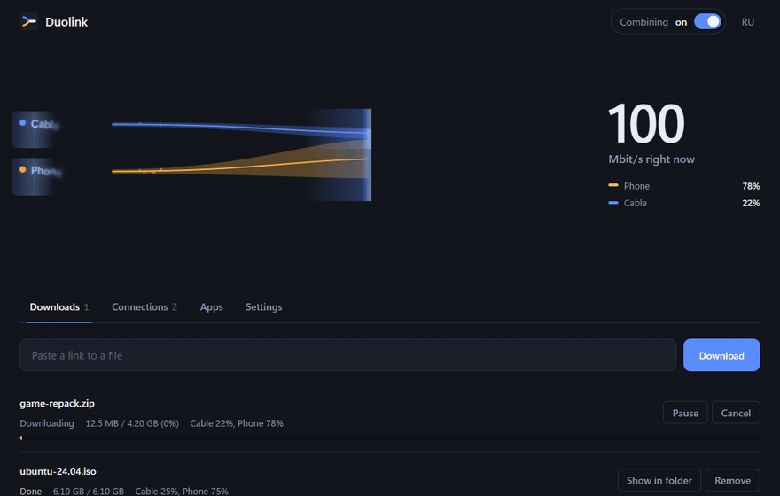
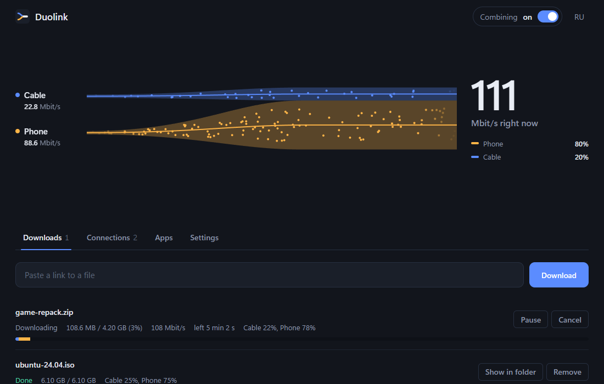
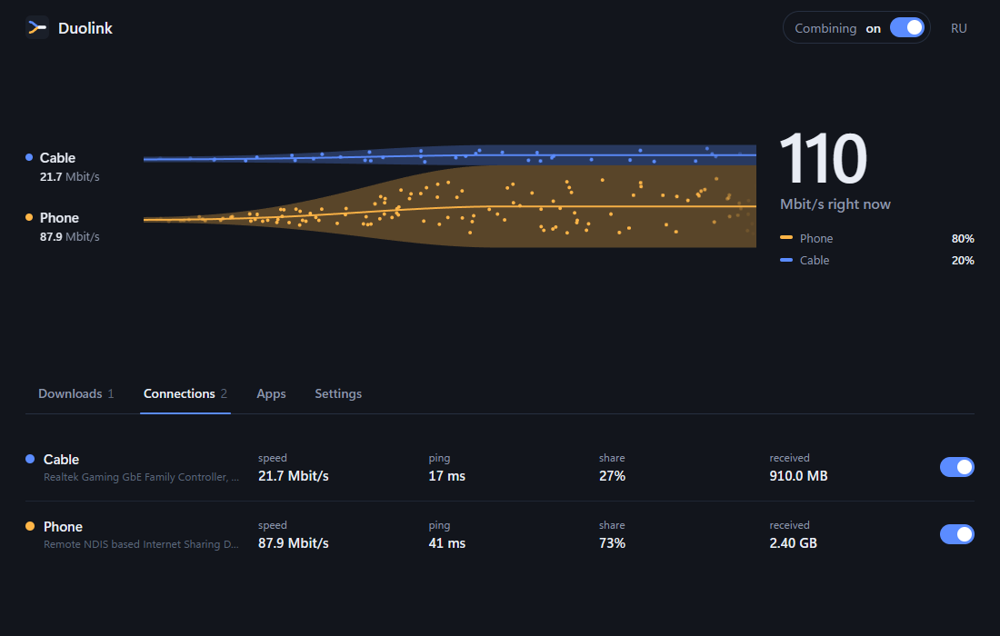
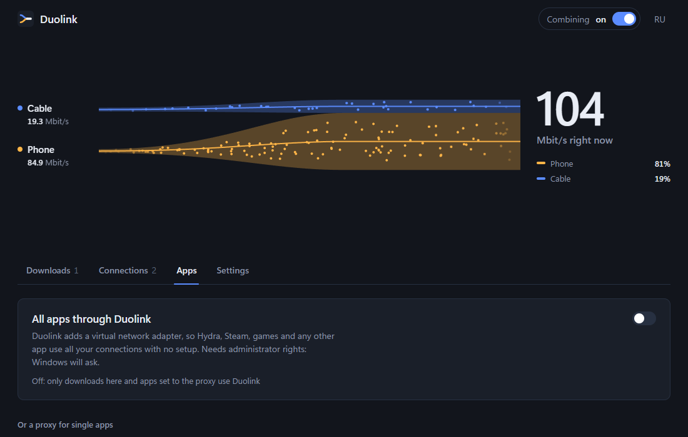
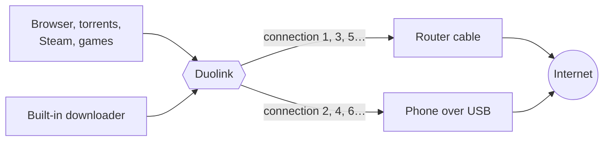

<div align="center">


# Duolink

**Use all your internet connections at once.**<br>
Cable, phone over USB, Wi-Fi: Duolink puts them to work together on one Windows PC.<br>
Fully local. No server, no account, no subscription.

**English** · [Русский](README.ru.md)

[](#install)
[](go.mod)
[](LICENSE)



</div>

## Why

Windows only ever uses one internet connection. If you have a slow router and a phone with good mobile data, one of them sits idle. Duolink spreads your traffic over every link you have, so downloads, torrents, Steam and game launchers get the sum of them.

On a real test with a 20 Mbit/s router and a 28 Mbit/s phone, a download through Duolink averaged **104 Mbit/s** and peaked at **155 Mbit/s**. That is more than the plain sum, because one stream per link hits a ceiling that several parallel streams do not.

## Features

| | |
|---|---|
| 🔌 **Finds connections by itself** | Every adapter that reaches the internet becomes a channel. Plug a phone in and it joins within seconds. Unplug it and traffic moves to the rest. |
| ⚡ **Multi-channel downloads** | Paste a link and the file is split into parts fetched over all channels at once. When a part is done, the free stream takes half of the largest remaining one, so every link is busy to the very end. |
| ⏯️ **Pause and resume** | Downloads survive a pause, a crash or a reboot and continue where they stopped. |
| 🌐 **All apps, no setup** | One switch adds a virtual network adapter, and every program goes through Duolink: browsers, torrents, Steam, Hydra, launchers. |
| 🧦 **Or a SOCKS5 proxy** | Point a single app at `127.0.0.1:1080` if you do not want everything to go through it. |
| 📌 **Sticky sites** | A site stays on the same channel for 10 minutes, so logins and banking that check your IP keep working. |
| 🔒 **100% local** | Each channel goes straight to the internet with its own IP. Nothing is sent to any server of ours, because there is none. |

## Screenshots

<table>
<tr>
<td></td>
<td></td>
<td></td>
</tr>
<tr>
<td align="center">Downloads</td>
<td align="center">Connections</td>
<td align="center">All apps through Duolink</td>
</tr>
</table>

## How it works



Duolink checks every link every few seconds and knows how fast each one is right now. Each new connection goes to the link that has the most room. The built-in downloader goes further and splits a single file into many ranged requests across all links.

## Limits

One connection always runs over one link. A single live stream, such as an online game, a video call or one download in another app, does not get faster. It can still be sent over the fastest link, and new connections move to another link if one drops. Splitting one connection across links needs a server on the other end, and Duolink is deliberately serverless.

## Install

1. Download `Duolink.exe` from [Releases](../../releases/latest).
2. Run it. A window opens and an icon appears in the tray.
3. Plug in your second connection (for example a phone in USB tethering mode). It shows up on the **Connections** tab.

Closing the window keeps Duolink in the tray, and the tray menu has **Quit**. It can start with Windows. The window uses Microsoft Edge WebView2, which ships with Windows 10 and 11. Settings are stored in `%APPDATA%\Duolink`.

> [!NOTE]
> The exe is not code-signed yet, so Windows SmartScreen may warn on first launch. Click **More info → Run anyway**, or build it yourself from the source below.

> [!NOTE]
> "All apps through Duolink" needs administrator rights to create the virtual adapter. Windows will ask once when you turn it on.

<details>
<summary><b>Command line options</b></summary>

| Option | Meaning |
|---|---|
| `-tray` | start hidden in the tray |
| `-tun` | turn on "all apps" mode at start (needs admin) |
| `-headless` | no window, the panel opens in the browser |
| `-ui 127.0.0.1:7878` | panel address |
| `-socks 127.0.0.1:1080` | SOCKS5 proxy address |
| `-dir <folder>` | download folder |
| `-workers 4` | parallel requests per channel |

Download from the terminal:

```
Duolink.exe get -o D:\Downloads https://example.com/big.iso
```

</details>

## Build from source

Go 1.26 or newer:

```
go build -ldflags "-H windowsgui -s -w" -o duolink.exe ./cmd/duolink
```

<details>
<summary>Embed the icon and version info</summary>

Needs [go-winres](https://github.com/tc-hib/go-winres):

```
go run ./cmd/genicon
go-winres make --in cmd/duolink/winres/winres.json --out cmd/duolink/rsrc --arch amd64
```

</details>

Add `#demo` to the panel address (`http://127.0.0.1:7878/#demo`) to see it with made-up traffic.

## License

[GPL-3.0](LICENSE). Contributions are welcome and require signing the [CLA](CLA.md), see [CONTRIBUTING](CONTRIBUTING.md).
