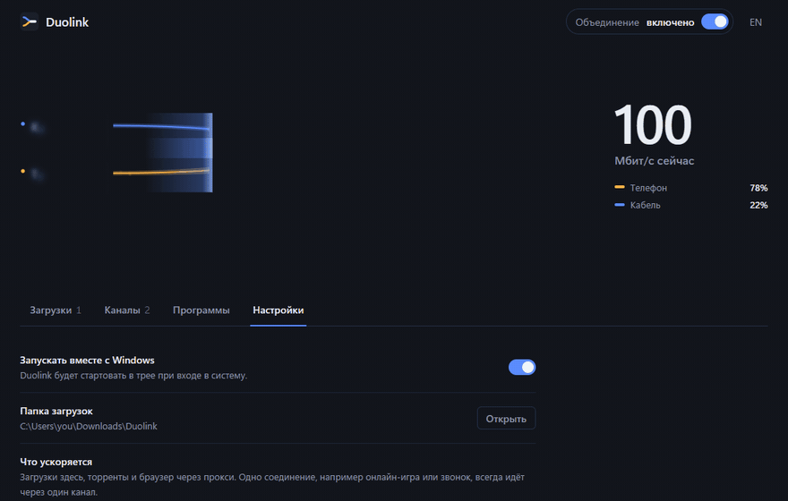
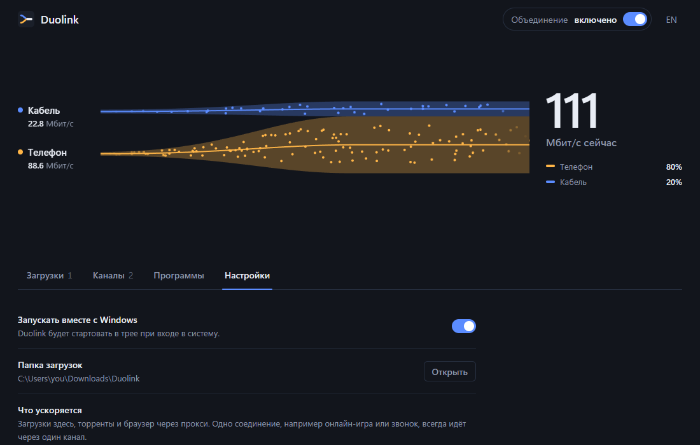
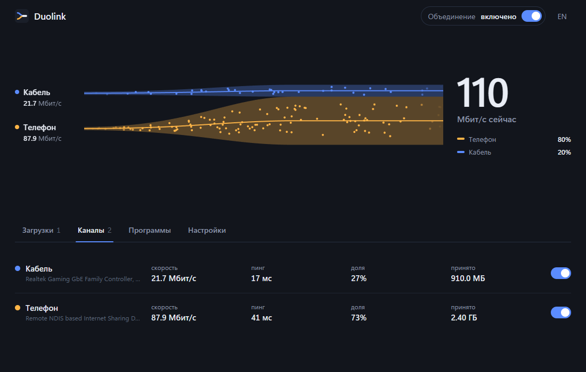
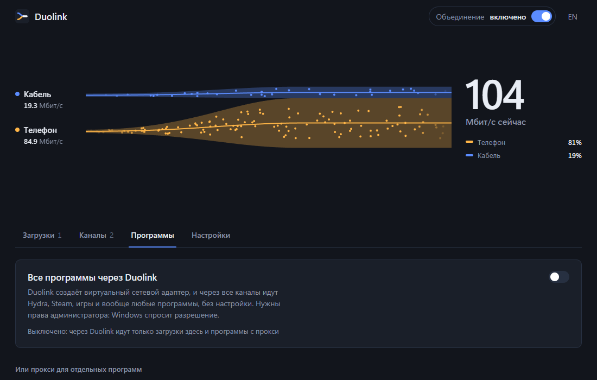
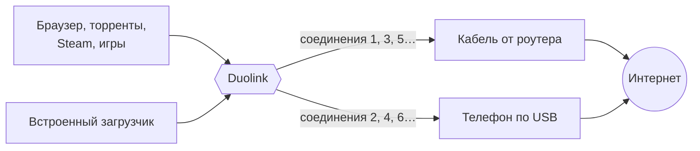

<div align="center">


# Duolink

**Все ваши подключения к интернету сразу.**<br>
Кабель, телефон по USB, Wi-Fi: Duolink заставляет их работать вместе на одном ПК с Windows.<br>
Полностью локально. Без сервера, без аккаунта, без подписки.

[English](README.md) · **Русский**

[](#установка)
[](go.mod)
[](LICENSE)



</div>

## Зачем

Windows всегда пользуется только одним подключением. Если у вас медленный роутер и телефон с хорошим мобильным интернетом, одно из них простаивает. Duolink раскидывает трафик по всем каналам, и загрузки, торренты, Steam и лаунчеры получают их сумму.

В реальном тесте роутер давал 20 Мбит/с, телефон 28 Мбит/с, а загрузка через Duolink шла в среднем на **104 Мбит/с**, в пике **155 Мбит/с**. Это больше простой суммы: один поток на каждом канале упирается в свой потолок, а несколько параллельных потоков его обходят.

## Возможности

| | |
|---|---|
| 🔌 **Сам находит подключения** | Каждый адаптер с выходом в интернет становится каналом. Подключили телефон — через несколько секунд он в деле. Отключили — трафик уходит на остальные. |
| ⚡ **Загрузка по всем каналам** | Вставьте ссылку: файл делится на части и качается сразу через все каналы. Освободившийся поток забирает половину самой большой оставшейся части, поэтому каналы загружены до самого конца. |
| ⏯️ **Пауза и продолжение** | Загрузка переживёт паузу, вылет и перезагрузку и продолжится с того же места. |
| 🌐 **Все программы без настройки** | Один переключатель добавляет виртуальный сетевой адаптер, и через Duolink идёт всё: браузеры, торренты, Steam, Hydra, лаунчеры. |
| 🧦 **Или SOCKS5-прокси** | Если не хотите пускать всё подряд, укажите `127.0.0.1:1080` в нужной программе. |
| 📌 **Липкие сайты** | Сайт 10 минут держится на одном канале, поэтому входы в аккаунты и банки, которые проверяют IP, не слетают. |
| 🔒 **Всё на вашем ПК** | Каждый канал выходит в интернет напрямую со своим IP. Никуда ничего не отправляется: нашего сервера просто нет. |

## Скриншоты

<table>
<tr>
<td></td>
<td></td>
<td></td>
</tr>
<tr>
<td align="center">Загрузки</td>
<td align="center">Каналы</td>
<td align="center">Все программы через Duolink</td>
</tr>
</table>

## Как это работает



Duolink каждые несколько секунд проверяет каналы и знает, насколько быстр каждый прямо сейчас. Новое соединение отправляется туда, где больше свободного места. Встроенный загрузчик идёт дальше: делит один файл на много запросов по частям и раскидывает их по всем каналам.

## Ограничения

Одно соединение всегда идёт через один канал. Один живой поток — онлайн-игра, видеозвонок, одиночная загрузка в другой программе — быстрее не станет. Но его можно пустить по самому быстрому каналу, а если канал отвалится, новые соединения уйдут на другой. Чтобы делить одно соединение между каналами, нужен сервер на другой стороне, а Duolink специально обходится без него.

## Установка

1. Скачайте `Duolink.exe` со страницы [Releases](../../releases/latest).
2. Запустите. Откроется окно, в трее появится значок.
3. Подключите второй интернет, например телефон в режиме USB-модема. Он появится на вкладке **Каналы**.

Если закрыть окно, Duolink останется в трее, выйти можно через меню значка. Программа умеет запускаться вместе с Windows. Окно работает на Microsoft Edge WebView2, он уже есть в Windows 10 и 11. Настройки лежат в `%APPDATA%\Duolink`.

> [!NOTE]
> У exe пока нет цифровой подписи, поэтому Windows SmartScreen может предупредить при первом запуске. Нажмите **Подробнее → Выполнить в любом случае** или соберите программу сами из исходников.

> [!NOTE]
> Режиму «Все программы через Duolink» нужны права администратора, чтобы создать виртуальный адаптер. Windows спросит один раз при включении.

<details>
<summary><b>Параметры командной строки</b></summary>

| Параметр | Что делает |
|---|---|
| `-tray` | запуск свёрнутым в трей |
| `-tun` | сразу включить режим «все программы» (нужен администратор) |
| `-headless` | без окна, панель открывается в браузере |
| `-ui 127.0.0.1:7878` | адрес панели |
| `-socks 127.0.0.1:1080` | адрес SOCKS5-прокси |
| `-dir <папка>` | папка загрузок |
| `-workers 4` | параллельных запросов на канал |

Загрузка из терминала:

```
Duolink.exe get -o D:\Downloads https://example.com/big.iso
```

</details>

## Сборка из исходников

Go 1.26 или новее:

```
go build -ldflags "-H windowsgui -s -w" -o duolink.exe ./cmd/duolink
```

<details>
<summary>Вшить иконку и версию в exe</summary>

Нужен [go-winres](https://github.com/tc-hib/go-winres):

```
go run ./cmd/genicon
go-winres make --in cmd/duolink/winres/winres.json --out cmd/duolink/rsrc --arch amd64
```

</details>

Допишите `#demo` к адресу панели (`http://127.0.0.1:7878/#demo`), чтобы увидеть её с выдуманным трафиком.

## Лицензия

[GPL-3.0](LICENSE). Правки приветствуются, для них нужно принять [CLA](CLA.md), подробнее в [CONTRIBUTING](CONTRIBUTING.md).
